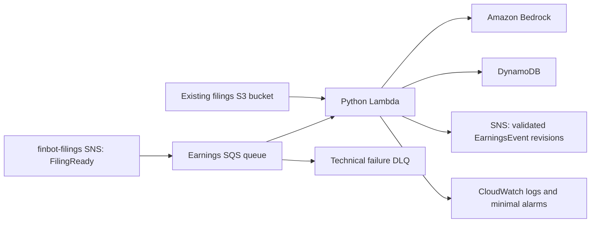

# finbot-earnings target architecture and processing behavior

Recorded 2026-10-14. This document summarizes the architecture discussed for the
repurposed package and the agreed processing behavior. It describes a target,
not the existing POC or a deployed earnings service. The filing-level producer implementation is in `finbot-filings`; production
adoption requires its normal release.

The filing core and AWS adapters are implemented separately from the POC. See
[OFFLINE_PROCESSING.md](OFFLINE_PROCESSING.md) for its SQLite reference adapter,
lease fencing, atomic event/outbox commits, explicit run identities and narrow
evidence policy. [AWS_RUNTIME.md](AWS_RUNTIME.md) describes the DynamoDB adapter,
SQS handler, CDK definitions and release workflows. They have not been deployed;
the initial configuration selects Nova Lite and disables consumption pending evaluation.

[FUNCTIONAL_SCOPE.md](FUNCTIONAL_SCOPE.md) defines package ownership and purpose.
[V0_DECISIONS.md](V0_DECISIONS.md) defines the minimal EPS response, validation
acceptance and canonical event identity/revisions. This document owns runtime
composition, filing-level input, operational behavior and deployment decisions.
[CONTRACTS.md](CONTRACTS.md) records the consumer expectations for the producer-owned
`FilingReady` contract and snapshot identity. AWS_RUNTIME.md records the initial
resource configuration and release procedures; activation remains separate work.

## Working architecture



| Component | Direction discussed |
| --- | --- |
| Input | Earnings-owned SQS queue subscribed to filing-level SNS notifications from `finbot-filings` |
| Compute | One SQS-triggered Python Lambda, initially deployed as a ZIP package |
| Inference | Bedrock, with one combined classification/extraction call per complete filing snapshot |
| Persistence | One earnings-owned DynamoDB table for compact results, processing state and preserved event revisions |
| Source documents | Read the immutable objects already stored by `finbot-filings`; retain their references |
| Output | SNS events containing the validated extracted details, for future independent consumers |
| Observability | Structured logs, built-in metrics and a small set of alarms |
| Delivery | GitHub Actions with Python CDK owning application code and infrastructure |

Lambda is recommended because this is bounded event-driven processing rather than
a continuously polling service. Start with one input message per invocation and
limited concurrency to control model traffic. The complete processing budget must
fit within the ordinary on-demand Lambda invocation limit of 15 minutes.
ECS remains an alternative if measured duration or document-processing needs
outgrow that approach. Initial timeout, concurrency, runtime and deployment settings
are now defined in AWS_RUNTIME.md. See [Lambda/SQS behavior](https://docs.aws.amazon.com/lambda/latest/dg/with-sqs.html)
and [Lambda limits](https://docs.aws.amazon.com/lambda/latest/dg/gettingstarted-limits.html).

## Filing-level input and readiness

The extraction unit is a filing snapshot containing all documents selected for
that package. Send those documents together with one prompt. Classification
answers whether the combined filing reports earnings; evidence must still identify
the individual source artifact.

For example, the user identified a JPM 8-K package with three stored documents:

```text
JPM/2026-10-13_8-K_0001628280-26-065582/
```

The intended behavior is one request containing all three documents, rather than
three independent extraction requests. Preserve artifact IDs and filenames in
the input so evidence can be attributed correctly. This example records the
discussed input, not a fresh inspection of the bucket.

The input contract is described in [CONTRACTS.md](CONTRACTS.md). Consume the
producer's complete selected filing snapshot and use its fixed document list for
this run. A later changed snapshot is a separate input; do not infer readiness
from S3 listings or individual document notifications.

`finbot-filings` owns selection, acquisition/readiness tracking, saved filing
notifications and their publication recovery. Its authoritative contract and
producer design are in [FILING_READY.md](../../finbot-filings/docs/FILING_READY.md)
in the sibling workspace checkout. Producer table layouts and checkpoints are
specified there. Earnings owns the subscription and consumer work/results.

## Work identity and duplicate handling

The agreed logical work identity is:

```text
filing_id + snapshot_id + extraction_config_version + run_mode
```

For an unchanged snapshot, this is the discussed filing ID/configuration key,
qualified by `production` or `evaluation`. The configuration version identifies
the model, prompt, extraction schema and relevant inference settings. Store the
exact manifest with the result. A changed snapshot must not be mistaken for a
duplicate merely because its accession is unchanged.

Work identity is distinct from canonical EarningsEvent identity:

```text
event_id = <cik>:<period_kind>:<period_end>
```

Multiple filing snapshots can contribute evidence to one company-period event.
The SQS message ID is transport metadata, not extraction identity.

SNS/SQS notifications and retries can deliver the same logical work again. Only
one worker may claim a given job at a time. Repeated deliveries reuse a durable
result or resume unfinished work; they must not automatically create a new LLM
run or event revision. The offline adapter uses expiring claims and fenced writes;
the DynamoDB adapter implements equivalent guarantees with conditional transactions.
A crash after model completion but before saving the response can still require
another call: one-call processing is not an exactly-once invocation guarantee.

## Processing and failure behavior

```text
Receive FilingReady → resolve/claim work → read complete manifest → check bounds
    → one classification/extraction call → validate → persist outcome
    → publish accepted production revision → checkpoint publication → acknowledge
```

| Outcome | Agreed behavior |
| --- | --- |
| Temporary technical failure | Retry within a bounded budget |
| Non-earnings | Persist completed outcome; acknowledge input; publish no validated event |
| Review required | Persist completed outcome and reasons; acknowledge input; publish no validated event |
| Validated production result | Persist accepted revision; publish; checkpoint publication before acknowledging completion |
| Completed evaluation | Persist comparison result; acknowledge input; do not update canonical events or publish |
| Exhausted technical failure | Retain available failure facts and route the input to the SQS DLQ for inspection and explicit redrive |

Completed processing means a durable outcome exists, not that validation passed.
Review outcomes do not enter an automatic retry loop. Explicit reprocessing can
create a distinguishable run. A supported fact may still be published when an
independent optional fact is withheld, under the acceptance rules in
V0_DECISIONS.md. Material conflicts affecting accepted facts block the candidate.

## Persistence and publication recovery

Keep one logical processing record containing source references, the input
manifest, model result, validation findings/outcome and accepted facts. Also
retain configuration/model versions, token usage, timing and publication state.
Classification, extraction and validation do not require separate records or
calls. The DynamoDB layout splits job STATE/INPUT/RESPONSE and event HEAD/REV items;
see AWS_RUNTIME.md. SQLite remains the separate offline reference adapter.

Persist the validated event revision and publication-pending state before sending
to SNS. Record successful publication after SNS acknowledges it. A publication
failure resumes from saved data without another model call; do not acknowledge
the input as successfully finished while its required publication remains pending.
Exhausted technical retries follow the same DLQ/redrive policy.

Lost publication acknowledgments can cause repeated SNS notifications. Repeat
the same logical revision and payload; consumers deduplicate by
`(event_id, revision)`. Do not claim exactly-once downstream delivery. Detailed
conditional writes for DynamoDB and SQLite transactions exercise these guarantees
in offline tests, including concurrent revision changes and lost acknowledgments.

The output notification contains a complete accepted snapshot: schema version,
event ID/revision, company identity, reporting period, accepted EPS facts with
their currencies and source evidence, source references and validation timestamp.
Downstream clients should receive the extracted details directly, not just a
storage pointer. The reference envelope is specified in CONTRACTS.md. Review candidates and
technical failures are not validated-event notifications.

No new application S3 bucket is needed for the bounded v0 extraction records.
Read original documents from the existing producer bucket without copying them
into DynamoDB. DynamoDB items have a [400-KB limit](https://docs.aws.amazon.com/amazondynamodb/latest/developerguide/Constraints.html);
keep evidence and responses bounded and preserve revisions without growing one
item indefinitely. Large future transcripts or derived files would need a
separate storage decision.

## Model replacement and experiments

Keep a small model adapter around this responsibility:

```text
classify_and_extract(filing_documents, company_context, schema)
    → extraction_result + model_usage
```

Validation, persistence and publication stay outside the adapter. The initial
`NovaLiteModel` adapter uses Bedrock Converse with `amazon.nova-lite-v1:0` in
`us-east-1`. It forces a single `report_earnings` tool with the minimal EPS schema
and reads the returned `toolUse.input`; it never executes a function or makes a
follow-up inference call. This is Nova's constrained tool-input approach, rather
than Converse native JSON text output. Application schema and financial evidence
checks remain necessary.

HTML, TXT and PDF files are supplied together as original document bytes with
artifact mappings. PDF-sourced facts require review until independent PDF evidence
validation exists. See [AWS_RUNTIME.md](AWS_RUNTIME.md) for versioned configuration
and input budgets. Other models can be compared later through separate adapters.

Use the same extraction and validation code in two modes:

- **Production:** update canonical events and publish accepted revisions.
- **Evaluation:** save results for comparison against the same frozen filing
  snapshot, without canonical updates or production publication.

Run mode is part of work identity so an evaluation result cannot suppress a
production job. Compare replacement models on reviewed filings before selecting
them for production. Deliberate repeated experiments need distinguishable run
identities; the core supplies an explicit `run_id`, defaulting to `initial`.

## Input bounds

Submit every artifact in the `FilingReady` manifest together, preserving source
labels. Check supported formats and aggregate document/input size against the
configured model's capabilities before calling it. Set finite model-output and
request budgets as part of the extraction configuration.

Never silently truncate documents or omit attachments to make a package fit.
If the complete snapshot is unsupported or oversized, persist a review outcome
with the reason and publish nothing. Missing or unreadable manifest objects are
technical failures subject to the retry/DLQ policy. V0 does not automatically
split a filing into multiple model calls.

## Minimal observability

Use structured logs for work identity, run mode, processing outcome, technical
failures, model latency and token usage. Persist usage with runs for experiments.
Start with built-in CloudWatch metrics rather than custom metric dimensions per
company, filing or model.

The recommended initial alarms are DLQ messages present, excessive input queue
age and repeated Lambda errors. Initial thresholds are defined in CDK; alarm
subscriptions require setup. Completed review outcomes should be inspectable in storage/logs rather
than treated as infrastructure failures.

## Deployment and release ownership

Use GitHub Actions for CI and deployment, retaining the offline checks, OIDC
authentication and protected production-environment approval pattern used by
`finbot-filings`. Keep application code and Python CDK infrastructure definitions
in this repository.

CDK owns both earnings application code and infrastructure through the approved
deployment workflow. This deliberately differs from `finbot-filings`, where
operators deploy infrastructure manually and GitHub delivers ECS application
revisions. One owner keeps Lambda code/configuration and the declared infrastructure
in sync without a separate baseline-versus-release configuration split.

The earnings CDK definitions own the input queue/DLQ, DynamoDB table, Lambda,
output SNS topic, earnings permissions and minimal alarms. Reference the producer’s
`filing-ready` SNS topic (`FilingTopicArn`) and existing raw-document bucket without taking ownership of them. The
producer's `FilingReady` implementation remains in `finbot-filings` and follows
that package's delivery process.

Package the Lambda as a ZIP initially, with dependencies built for its selected
Linux runtime and architecture. CDK deploys the bundled code as an asset; a
separate application container image is not needed for v0. CDK deployment assets
use deployment storage, distinct from application document/extraction storage.
See [CDK assets](https://docs.aws.amazon.com/cdk/v2/guide/assets.html).

### Workflows

| Workflow | Initial trigger | Responsibility |
| --- | --- | --- |
| `ci.yml` | Pull requests and pushes to `main` | Offline application tests, package build, infrastructure tests, CDK synthesis and workflow checks |
| `deploy.yml` | Manual dispatch | Deploy a reviewed `main` commit after successful CI and production approval |

CI uses mocked AWS/model boundaries, receives no AWS deployment credentials and
makes no paid Bedrock calls. Deployment must use the selected commit and tested
package, not an unpinned moving branch. Present the infrastructure diff for review
before applying it, including releases primarily changing application code.
Serialize deployments so releases do not overlap.

Authenticate through GitHub OIDC using a dedicated earnings deployment role scoped
to the repository and protected production environment. Use temporary credentials
rather than long-lived AWS keys in GitHub. Initial setup of trust, deployment roles
and any shared CDK bootstrap prerequisites is a separate authorized operation.
The earnings deployment identity is separate from the Lambda runtime identity.
See [GitHub OIDC for AWS](https://docs.github.com/en/actions/how-tos/secure-your-work/security-harden-deployments/oidc-in-aws).

Keep deployment dispatch manual for v0. Once releases are routine, successful
`main` CI may prepare a deployment automatically while retaining production
approval. Automatic preparation is a later choice, not the initial trigger.

### Versions, activation and rollback

Publish immutable Lambda versions and point a stable production alias at the
selected version; the queue event source targets that alias. Retain compatible
versions for rollback through the same deployment process. Rollback must respect
existing processing/event schemas and reviewed infrastructure changes rather than
blindly restoring an incompatible old revision. See [Lambda versions](https://docs.aws.amazon.com/lambda/latest/dg/configuration-versions.html).

For initial activation, deploy with queue consumption disabled. Verify the deployed
function using an explicit evaluation run, then enable consumption through reviewed
CDK configuration. Normal processing requires the upstream `FilingReady` contract
to be implemented. Model experiments remain separate from deployment and do not
publish production events.

Retain release evidence identifying the commit, package hash, deployed Lambda
version and extraction configuration version. Detailed build steps, role policies,
deployment inputs, activation verification and rollback are documented in the
workflows and [AWS_RUNTIME.md](AWS_RUNTIME.md). Initial OIDC roles and production
environment protection still require cloud/repository setup.

## Remaining design and implementation work

- Verify the initial cloud deployment and production environment/OIDC setup.
- Evaluate the configured Nova Lite baseline on reviewed filing snapshots.
- Broader reconciliation beyond economic duplicates, enrichment and conflicts.
- Expand and evaluate the initial explicit-prose evidence policy on reviewed filings.
- Tune input/output limits and timeouts against the chosen model and real filings.
- Operator CLI commands for inspection, explicit reruns and selective DLQ redrive.

Application validation should use offline fixtures and mocked model/AWS boundaries;
paid evaluations and cloud activation are separate operations. Recording this
architecture alone changes no cloud resources. The offline implementation does
not connect to AWS or a live model. Cloud adapters are tested with local emulation
and SDK stubs; deployment and paid evaluations remain separate operations.
