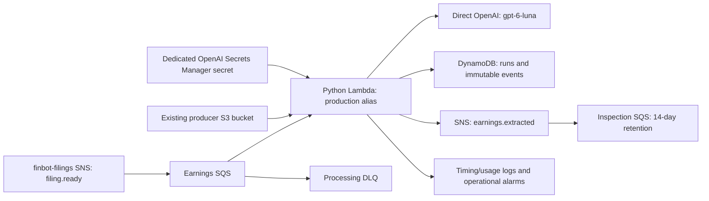

# finbot-earnings target architecture and processing behavior

Updated 2026-10-25 for Milestone 1. This is the approved migration target.
[OFFLINE_PROCESSING.md](OFFLINE_PROCESSING.md) and current-runtime sections of
[AWS_RUNTIME.md](AWS_RUNTIME.md) describe the unchanged Nova/prose-validation/
canonical-revision implementation. Actual deployed state remains unverified.
[FUNCTIONAL_SCOPE.md](FUNCTIONAL_SCOPE.md) owns scope, [V0_DECISIONS.md](V0_DECISIONS.md)
acceptance, [CONTRACTS.md](CONTRACTS.md) fields/identity, and [ROADMAP.md](../ROADMAP.md)
sequence and approvals.

## Target composition

Retain SNS/SQS/Python Lambda/DynamoDB/CDK/GitHub delivery and SQLite offline tests.
The inspection queue and dedicated secret are target additions, not verified live
resources. Producer bucket/topic remain producer-owned. Sources remain immutable
in producer storage; raw responses, full manifests, usage and processing provenance
remain accessible through durable processing references.

Target account `559007813222`, `us-east-1`, stack `finbot-earnings-prod`. Inspect
actual resources and preserve stateful logical IDs before release. Worker retrieves
only its dedicated secret through an ARN with narrowly scoped access. Never embed
credentials in source, templates, output, logs or release evidence.

## Complete input and extractor boundary

Validate the producer's immutable selected [FilingReady](../../finbot-filings/docs/FILING_READY.md)
manifest, then load every member with bounded I/O. No S3 readiness scan, extra
acquisition or waiting for later reports. Check supported formats and complete
bounds before inference. HTML becomes tested plain text; all original JPEG/PNG/GIF
supporting images enter one request with identity/context/ordering retained.
TXT/PDF or other unsupported members send the whole snapshot to review, including
mixed HTML/PDF. No attachment omissions, text truncation or multiple-call split.
The isolated extractor's [frozen bounds](EXTRACTOR.md#frozen-bounds-and-unsupported-inputs)
cover the HON 34-image case; consumer integration follows in Milestone 3.

A small injected extractor returns the fiscal v2 object, native response, usage
and timing/request provenance. Milestone 2 implements
`processing.fiscal.OpenAIFiscalExtractor.extract(filing, source, run_id=..., attempt=...)`
returning a serializable receipt. Schema-valid `extracted` is distinct from
business acceptance; the existing consumer has not been switched.
Use tested prompt/schema/preparation/settings in V0_DECISIONS, traceably ported
from evals without sibling imports or evaluation-app dependency. No invented
classifier/evidence fields to fit old interfaces.

## Identity, history and concurrency

Work includes new namespace, filing ID, snapshot ID, configuration version/content
digest and explicit run ID; CONTRACTS defines encoding. Transport IDs/times do not
identify extraction. Changed snapshots/amendments/new runs are independent work.
Duplicates resume checkpoints or reuse completion. No cross-filing merge/value
conflict gate delays another filing's accepted event.

Claims expire; every owned checkpoint checks token/expiry. Preserve SQLite
transactions and equivalent DynamoDB conditional/transactional guarantees. Save
response before acceptance. Commit outcome, immutable event and publication intent
atomically. No target company-period HEAD/revision. Milestone 3 selects physical
keys/indexes and status-list query design in a namespace separate from legacy
jobs/events, preserving old records rather than reinterpreting their payloads.

One accepted work identity produces one event with both EPS arrays, issuer, one
source filing/snapshot and model/configuration/run/acceptance provenance. No
revision counter, required period-end date or per-fact citation. Full manifest and
response are reachable through processing references.

## Completion and recovery

| Condition | Behavior |
| --- | --- |
| Nonempty valid single-period response | `accepted`; persist, publish saved event immediately, save acknowledgment, then acknowledge input |
| Empty arrays | Complete `no_eps_extracted`; acknowledge, no event/automatic inference retry |
| Unsupported/oversized input or business conflict | Complete `review_required`; retain artifact/bound/row reasons, acknowledge, no event/automatic inference retry |
| Temporary read/provider/storage/publication failure | Persist stage failure and bounded retry/resume |
| Invalid model JSON/schema or permanent technical failure | `processing_failed`; no automatic new inference; retain checkpoint for explicit recovery |
| Exhausted technical failure | Remain unacknowledged for SQS redrive/DLQ, with durable reasons |

Retry saved publication intent with identical serialized bytes/ID, no source reads
or inference. Save actual acknowledgment/time separately. Lost acknowledgments can
repeat delivery; consumers deduplicate by event ID. A crash before saving response
may repeat inference. Neither inference nor delivery is promised exactly once.

Retry/rearm uses existing checkpoints; fresh extraction requests a new run/config.
Review/empty outcomes require explicit new-run processing following inspection.
Never mutate or automatically republish legacy canonical events. New accepted
runs publish even if EPS is unchanged.

Response/event/item bounds remain finite. Milestones 2–3 choose limits/storage
handling without losing provenance or partially committing a filing. Do not assume
the existing small DynamoDB response budget fits the new native response. If
storage overflow needs another durable mechanism, document that engineering choice
before relying on it; this milestone does not mandate an application bucket.

## Operations, latency and releases

Milestone 3 supplies CLI inspection/listing, checkpoint retry, fresh extraction and
output-queue inspection, with inference/publication effects clear. Experiments
remain in `finbot-filing-evals`. Verify port parity against the saved 50-filing v6
baseline in Milestone 5; no automatic paid repeat campaign.

Measure `ready_at` to first publication acknowledgment and queue/input/extraction/
persistence/publication stages. `filed_at` is SEC acceptance, not discovery; only
measure discovery/acquisition with real timestamps. Report unavailable data and
backlog catch-up separately. Launch-and-measure has no hard numeric SLA. Choose
finite concurrency/timeouts/leases/visibility/retries consistent with real provider
quotas and observed traffic. Current Nova settings are not OpenAI launch limits.

Alarms cover processing/publication failures, dead letters, excessive queue delay
and worker errors. Earnings alarm SNS delivers to `ilancooke@gmail.com`; confirm
setup/delivery before activation. Review/empty outcomes are visible in CLI. Retain
usage and cost estimates, without application spend caps/alerts/funding automation.
User-managed OpenAI funding is separate from the cumulative USD 5 API test ledger.

CI builds the exact release artifact. Manually dispatched Deploy verifies it,
shows the infrastructure diff, and requires protected production approval. Complete
implementation and concrete release evidence before approval. Milestone 6 first
deploys disabled, verifies secret/provider/alarm/output setup, inspects backlog,
then enables through the protected workflow. Process all retained notifications;
no silent purge/skip or automatic historical backfill. Completion requires real
queue-triggered EPS receipt in inspection SQS beyond an SNS acknowledgment/direct
invoke. Build Linux-compatible assets before synthesis and verify actual state.

Routine releases preserve consumption state with one normal release and no
automatic disable/enable cycle. Pausing is deliberate. Rollback checks storage/
schema compatibility and consumption settings while retaining history. Cloud setup
and deployment remain Milestone 6, not changes authorized in this documentation
session. See AWS_RUNTIME for existing release tools and target prerequisites.
